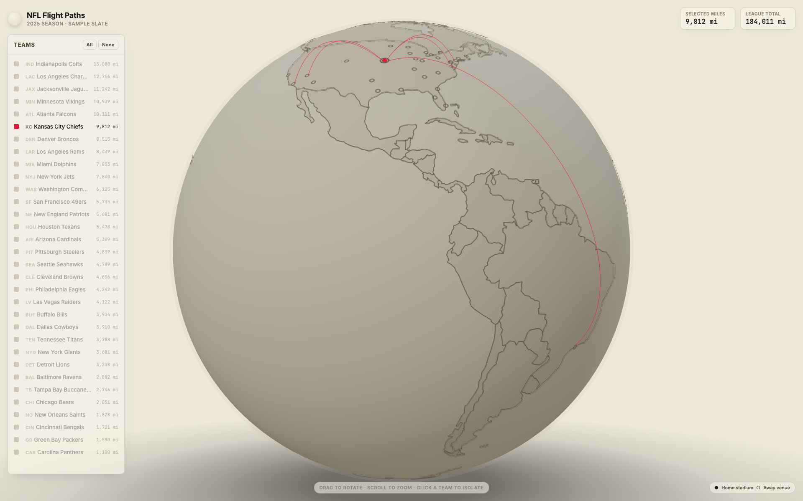
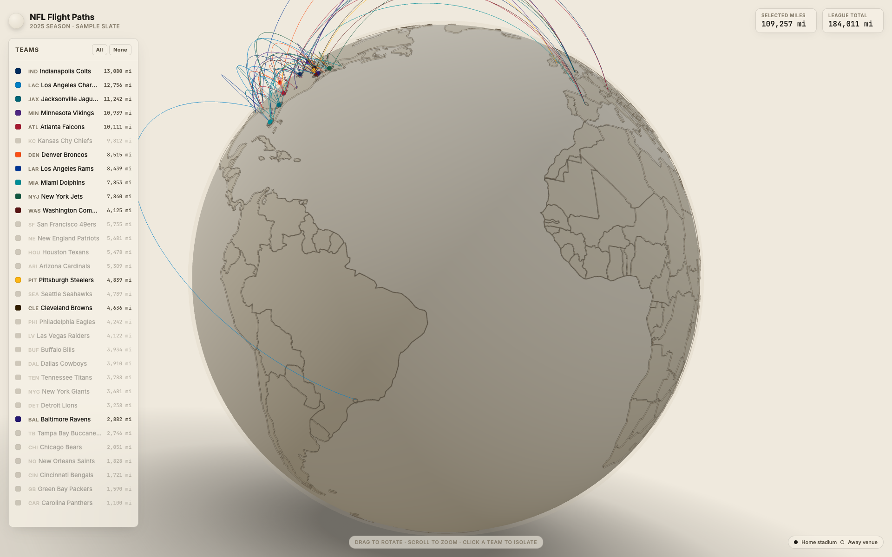
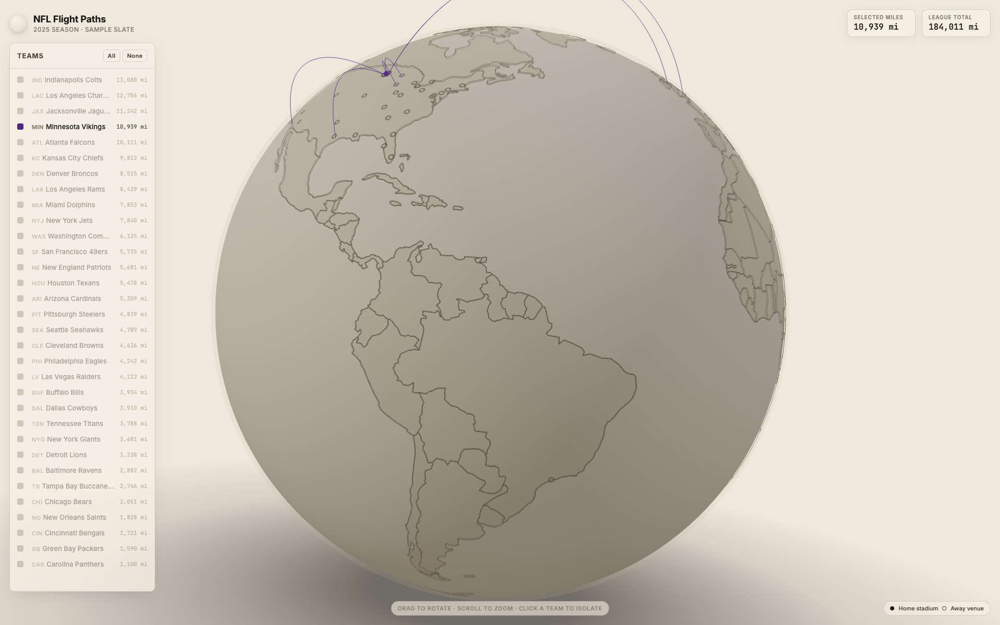

# NFL Flight Paths · A Travel-Schedule Globe


[](https://x.com/cypher_poet) [](https://www.paypal.com/ncp/payment/L6M553P28YPDY) [](https://cash.app/$CypherPoet) [](https://buymeacoffee.com/cypherpoet) [](https://linktr.ee/CypherPoet) [](https://github.com/CypherPoet/THREE-JS-NFL-Flight-Paths/blob/main/LICENSE)

[](https://cypherpoet.github.io/THREE-JS-NFL-Flight-Paths/) [](https://threejs.org/) [](#the-2026-slate)

A small interactive Three.js scene that plots **every NFL road trip** of a season as a great-circle arc on a clay-styled globe. Pick a team, watch their tour of the league light up, and read off the total air miles they'll log. Built as a way to stare at travel inequality — Seattle vs. Boston, transatlantic detours, the brutal three-game west-coast swing — without squinting at a spreadsheet.

→ **Open the live globe · [cypherpoet.github.io/THREE-JS-NFL-Flight-Paths](https://cypherpoet.github.io/THREE-JS-NFL-Flight-Paths/)**

---

## What's inside

- **A clay globe with real country shapes.** Land masses are painted from a world TopoJSON, baked into both a colour map and a bump map so the continents have subtle relief — the same trick the reference concept uses. A soft drop-shadow underneath the sphere sells the 3D.
- **Every away game, every team.** 256 regular-season games + the eight 2025 international fixtures (São Paulo, Dublin, London twice, Madrid twice, Munich), drawn as great-circle arcs from the travelling team's home stadium to the destination venue.
- **Team-coloured arcs.** Each path is painted in its travelling team's primary brand accent (`#E31837` for KC, `#4F2683` for Minnesota, and so on). Stadium markers wear the same colour.
- **Filter by clicking.** Click a team to toggle it off; click again to bring it back. **Solo a single team** with Shift/Cmd-click. Use the *All* / *None* buttons at the top of the panel for sweeping selections. The team list is pre-sorted by total miles travelled.
- **Live mileage tally.** The header shows the league-wide total (≈184k miles for the 2025 sample slate) and the sum of just the teams you've selected — handy for asking *"how far does the NFC West fly?"*

## A look around

| | |
|---|---|
|  |  |
| Kansas City solo'd — the red arcs trace their nine road games | Spin the globe to see transatlantic arcs hop to London, Dublin, Madrid |
|  | |
| Minnesota's purple arcs — including two of the season's international games | |

## The 2025 slate

The current `src/data/schedule-2025.js` mirrors the 2025 NFL regular season:

- All 8 divisions play 6 intra-division games
- AFC East ↔ NFC West, AFC North ↔ NFC South, AFC South ↔ NFC North, AFC West ↔ NFC East (the four-year-rotation full crossovers)
- Intra-conference rotations: AFC East ↔ AFC North, AFC South ↔ AFC West, NFC East ↔ NFC South, NFC North ↔ NFC West
- The standard 17th game (intra-conference, opposite-division, same prior-year standing)
- Eight international fixtures at neutral sites — each counts as a travel leg for **both** teams since neither plays at home

A travel leg is computed as the haversine great-circle distance between the away team's home stadium and the destination venue. Coordinates for all 32 stadiums (and the international venues) live alongside team accent colours in `src/data/teams.js`.

## The 2026 slate

The 2026 NFL season schedule is unveiled **Thursday, May 14 at 8:00 PM ET**. Once it drops, swapping in real 2026 data is a one-file change: replace `src/data/schedule-2025.js` with a `schedule-2026.js` of the same shape and update the import in `src/schedule.js`. No other code needs to move.

## How it works

```
┌─────────────────────────────────────────────────────────────┐
│  Build (vite)                                               │
│   ├── src/data/teams.js          32 teams + intl venues     │
│   ├── src/data/schedule-2025.js  every game of the season   │
│   └── data/countries-110m.json   world topology @ 110m      │
└─────────────────────────────────────────────────────────────┘
                              ↓
┌─────────────────────────────────────────────────────────────┐
│  Runtime                                                    │
│   ├── globe.js     paints land to canvas (d3-geo) →         │
│   │                  diffuse + bump map on a SphereGeometry │
│   ├── geo.js       lat/lon → Vector3, great-circle arc      │
│   ├── schedule.js  away-game legs, miles, per-team totals   │
│   ├── paths.js     one Line per leg, one marker per stadium │
│   ├── ui.js        sortable team list, miles formatter      │
│   └── main.js      camera, OrbitControls, lighting, loop    │
└─────────────────────────────────────────────────────────────┘
```

### Design system

| Role | Family | Why |
|------|--------|-----|
| Display + body | [Inter](https://fonts.google.com/specimen/Inter) | Modern, neutral; reads small without going stiff |
| Mono | [JetBrains Mono](https://fonts.google.com/specimen/JetBrains+Mono) | Tabular figures for the mileage column |

Palette: vellum `#efe9dd`, paper `#f6f1e6`, ink `#1c1a16`, soft ink `#514a3d`. Team accents pulled from each franchise's primary brand colour.

## Run it locally

```bash
git clone git@github.com:CypherPoet/THREE-JS-NFL-Flight-Paths.git
cd THREE-JS-NFL-Flight-Paths
npm install
npm run dev
```

Then open the printed URL (default <http://localhost:5173/THREE-JS-NFL-Flight-Paths/>).

A production build goes to `dist/`:

```bash
npm run build
npm run preview          # serve dist/ at localhost:4173
```

## Deploy

This repo ships with `.github/workflows/deploy.yml`, which on every push to `main`:

1. `npm ci` → `npm run build`
2. Uploads `dist/` as a GitHub Pages artifact
3. Deploys to `https://<owner>.github.io/THREE-JS-NFL-Flight-Paths/`

Make sure GitHub Pages is set to **GitHub Actions** under `Settings → Pages` for the repo.

## Project layout

```
.
├── index.html                       — shell + topbar/panel markup
├── styles.css                       — typography + HUD chrome
├── vite.config.js                   — base path for GitHub Pages
├── data/
│   └── countries-110m.json          — Natural Earth via world-atlas
├── src/
│   ├── main.js                      — wires scene, lighting, controls
│   ├── globe.js                     — sphere + painted land + bump map
│   ├── paths.js                     — great-circle arcs + markers
│   ├── schedule.js                  — legs → per-team mileage summary
│   ├── geo.js                       — lat/lon math, arc sampling
│   ├── ui.js                        — team panel + filter wiring
│   └── data/
│       ├── teams.js                 — stadium coords + accent colours
│       └── schedule-2025.js         — 2025 regular-season slate
├── media/                           — README screenshots
├── .claude/skills/                  — capture-museum-media + threejs/* reference skills
└── .github/workflows/deploy.yml     — Pages build/deploy on push to main
```

## Acknowledgements

- **[Three.js](https://threejs.org/)** by [Ricardo Cabello](https://mrdoob.com/) & contributors
- **[d3-geo](https://github.com/d3/d3-geo)** + **[topojson-client](https://github.com/topojson/topojson-client)** by Mike Bostock — for painting the world to a canvas
- **[world-atlas](https://github.com/topojson/world-atlas)** — the 110m TopoJSON used as the land source
- **Stadium coordinates** are public-domain venue locations; **team brand colours** are the franchises' own. This project is an unofficial fan visualisation and is not affiliated with the NFL.
- **Typefaces**: [Inter](https://fonts.google.com/specimen/Inter) by Rasmus Andersson; [JetBrains Mono](https://fonts.google.com/specimen/JetBrains+Mono) by JetBrains

## License

MIT — see [`LICENSE`](LICENSE). Team marks, logos, and league names are the property of their respective owners and used here under nominative fair use for non-commercial visualisation.

---

If this changed how you think about the AFC West's quarterback's frequent-flyer balance, click another team. ✈️
