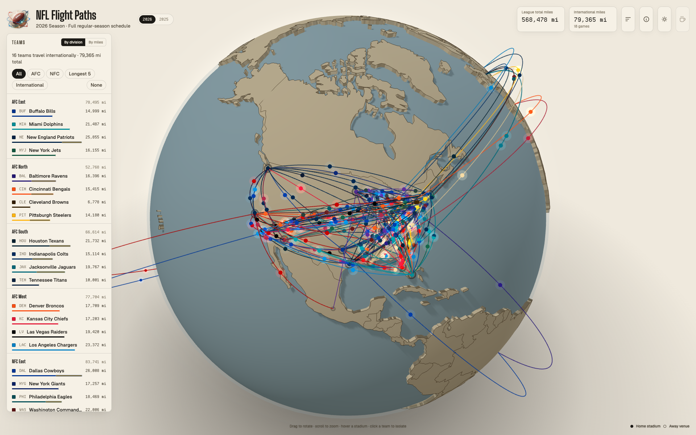
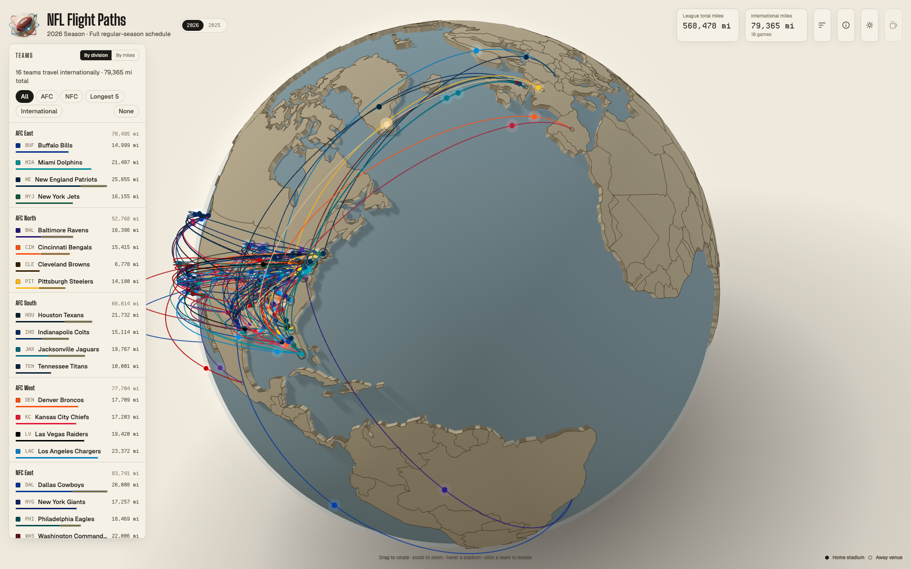
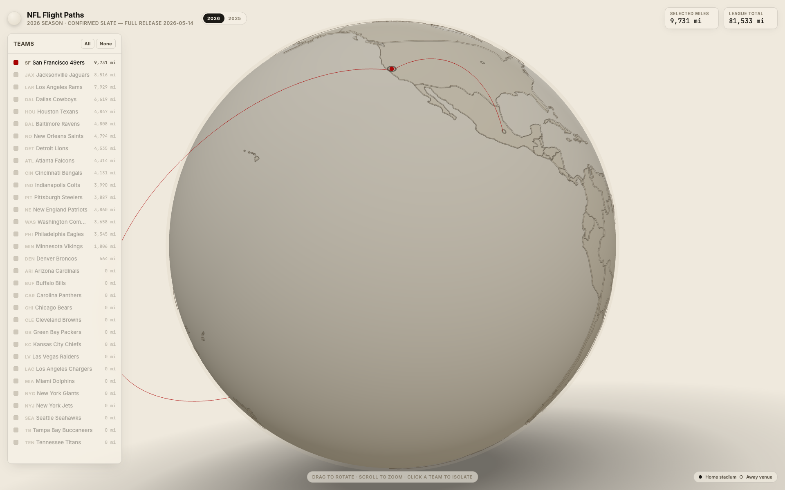
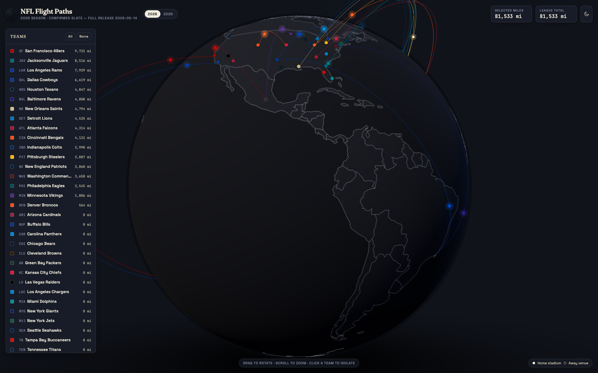
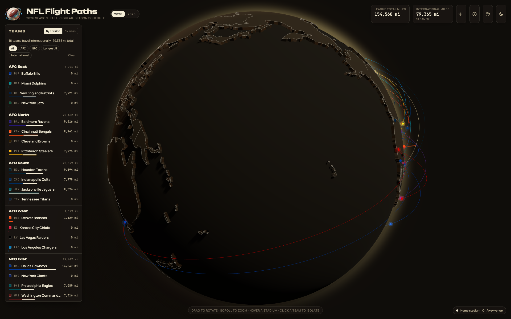

# NFL Flight Paths · A Travel-Schedule Globe



[](https://x.com/cypher_poet) [](https://www.paypal.com/ncp/payment/L6M553P28YPDY) [](https://cash.app/$CypherPoet) [](https://buymeacoffee.com/cypherpoet) [](https://linktr.ee/CypherPoet) [](https://github.com/CypherPoet/THREE-JS-NFL-Flight-Paths/blob/main/LICENSE)

[](https://cypherpoet.github.io/THREE-JS-NFL-Flight-Paths/) [](https://threejs.org/) [](#the-schedule)

A small interactive Three.js scene that plots **every confirmed NFL road trip of the 2026 season** as a great-circle arc on an interactive globe. Pick a team, watch their tour of the league light up, and read off the total air miles they'll log. Built as a way to stare at travel inequality — Seattle vs. Boston, transatlantic detours, the trans-Pacific haul to Melbourne — without squinting at a spreadsheet.

→ **Open the live globe · [cypherpoet.github.io/THREE-JS-NFL-Flight-Paths](https://cypherpoet.github.io/THREE-JS-NFL-Flight-Paths/)**

---

## What's Inside

- **A sculpted globe with real country shapes.** Continents are rendered as 3D elevated plates with etched country borders, sitting above a smooth ocean.
- **Animated travelers.** Every arc is ridden by a small team-coloured pellet looping from home stadium to destination venue, with a soft additive glow that pulses in flight.
- **Team-coloured arcs.** Each flight path uses the travelling team's primary brand accent. Stadium markers and travelers match.
- **Light + dark modes.** A toggle in the top bar swaps the whole scene to a coordinated palette and remembers the choice.
- **Filter by clicking.** Click a team to toggle it; *All* / *None* for sweeping selections. The team list is sorted by total miles travelled.
- **2026 ↔ 2025 toggle.** Flip between the in-progress 2026 slate and a full 2025 reference slate.
- **Live mileage tally.** League-wide total + sum of selected teams in the header.

## A Look Around

| | |
|---|---|
|  |  |
|  |  |

## The Schedule

Schedules live in `src/data/schedule-2026.js` and `src/data/schedule-2025.js` — the 2026 file is the load-bearing input and the 2025 file is a full-season reference. Stadiums + international venues + team accent colours live in `src/data/teams.js`. A travel leg is the great-circle distance from the away team's home stadium to the destination venue; for international games, **both** teams get a leg since neither plays at home.

## Run It Locally

```bash
git clone git@github.com:CypherPoet/THREE-JS-NFL-Flight-Paths.git
cd THREE-JS-NFL-Flight-Paths
npm install
npm run dev
```

Then open the printed URL (default <http://localhost:5173/THREE-JS-NFL-Flight-Paths/>).

A production build goes to `dist/`:

```bash
npm run build
npm run preview          # serve dist/ at localhost:4173
```

## Deploy

This repo ships with `.github/workflows/deploy.yml`, which on every push to `main`:

1. `npm ci` → `npm run build`
2. Uploads `dist/` as a GitHub Pages artifact
3. Deploys to `https://<owner>.github.io/THREE-JS-NFL-Flight-Paths/`

Make sure GitHub Pages is set to **GitHub Actions** under `Settings → Pages` for the repo.

## Acknowledgements

- **[Three.js](https://threejs.org/)** by [Ricardo Cabello](https://mrdoob.com/) & contributors
- **[d3-geo](https://github.com/d3/d3-geo)** + **[topojson-client](https://github.com/topojson/topojson-client)** by Mike Bostock — for working with the world topology
- **[world-atlas](https://github.com/topojson/world-atlas)** — the 110m TopoJSON used as the land source
- **2026 schedule data** sourced from the league's pre-release announcements on [nfl.com](https://www.nfl.com/news/2026-nfl-schedule-release-nine-international-games-dates-times-matchups)
- **Stadium coordinates** are public-domain venue locations; **team brand colours** are the franchises' own. This project is an unofficial fan visualisation and is not affiliated with the NFL.
- **Typefaces** served via [Google Fonts](https://fonts.google.com/) — current selection is wired in `index.html`

## License

MIT — see [`LICENSE`](LICENSE). Team marks, logos, and league names are the property of their respective owners and used here under nominative fair use for non-commercial visualisation.

---

If this changed how you think about the AFC West's frequent-flyer balance, click another team. ✈️
